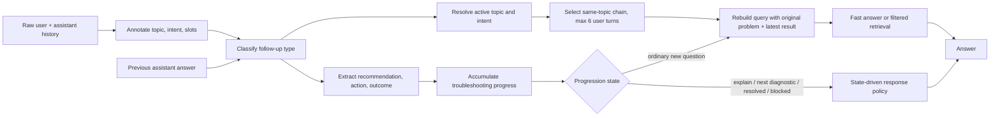

# Follow-up Reasoning and Troubleshooting Progression Review

Date: 2026-08-30

## Outcome

The agent now treats a result such as “I tried my roommate's port and it works” as a continuation of the active troubleshooting problem. It retains the relevant assistant recommendation, represents the reported action and result, advances to the next diagnostic or escalation stage, and does not send the fragment through the scope guard as a new question.

The final fixed evaluation contains 50 bilingual conversations, 130 user turns, and 10 long chains. Both the deterministic state gate and the live `/chat` gate pass 50/50 conversations and 130/130 turns.

## Root-cause findings

The baseline failures were architectural rather than a missing answer in the system prompt:

1. `_annotate_history` cleared the active topic whenever a user fragment lacked the small legacy follow-up cue list. Natural action reports such as “Tried that. Still doesn't work.” therefore became `unknown`.
2. Context resolution inspected the current user text but not the immediately preceding assistant recommendation or diagnostic question.
3. Assistant messages existed in raw history, but selecting a single referenced user turn did not preserve the wider troubleshooting chain. Intent switches also discarded referenced history before the result could be interpreted.
4. State represented topic, intent, relation, and semantic slots, but it could not represent a completed action, its outcome, partial results, resolution, or the assistant recommendation being answered.
5. Query reconstruction often used only the incomplete current fragment, so retrieval and the scope guard saw an underspecified standalone request.
6. Even after state resolution, the legacy single-turn fast-answer layer replayed a whole FAQ. It repeated completed work, exposed escalation details too early, or ignored a resolved state.

Baseline evidence from the same fixed grader:

- State-only: 0/50 conversations; follow-up resolution 0/80; action-result understanding 0/32; diagnostic handling 0/12.
- Live `/chat`: 0/50 conversations; incorrect refusal 25/80 (31.25%); escalation accuracy 24/40 (60%).
- Baseline failure counts: 80 follow-up resolution, 83 previous-recommendation, 46 action-result, 80 troubleshooting-stage, 25 incorrect-refusal, 12 missing-escalation, and 4 premature-escalation errors.

## State design decision

| Candidate | Decision | Representation |
|---|---|---|
| `active_problem` | Do not add | Existing `current_topic` + `current_intent` + selected original user turn represent it without duplicating text. |
| `topic`, `intent`, entities | Keep | Existing fields and `semantic_slots`; intent inheritance now understands structured follow-ups. |
| `troubleshooting_stage` | Derive | `followup_type`, `troubleshooting_progress`, and `resolution_status` are less lossy than one stage label. |
| `previous_recommendation` | Add as derived request state | `previous_recommendations` is extracted from the relevant preceding assistant answer; it is reconstructed, not persisted separately. |
| `pending_action` | Do not add | Derived from previous recommendations and `pending_question`. |
| `completed_action`, `action_result` | Add structured representation | `current_action_results` and the accumulated `troubleshooting_progress` store action, outcome, detail, and turn ID. |
| `resolution_status` | Add | `in_progress`, `resolved`, or `blocked`. |
| `escalation_required` | Do not persist | The response policy derives escalation from service, action outcome, completed progress, and the current request. |

The request-scoped design prevents state growth: raw conversation history remains the source of truth, while action progress is reconstructed for the active topic. A six-user-turn prompt window limits generation context, but progression derivation can inspect the full same-topic history supplied by the caller.

## Implemented flow



The follow-up taxonomy is intentionally smaller than the candidate list:

- `new_question`
- `action_result`
- `diagnostic_answer`
- `recommendation_question`
- `recommendation_rejected`
- `correction`
- `continuation`

Existing relation and reference fields continue to represent topic switch, intent switch, ordinal/named backward reference, and unresolved clarification. This avoids two overlapping classification systems.

The action/result ontology is reusable across services. It recognizes actions such as cross-test, reconnect, forget network, status check, password reset, server check, VPN activation, account correction, application, and escalation contact. Outcomes include works, still fails, partial, pending, unavailable, disabled, completed, provided, and diagnostic facts such as peer works or credentials work.

The response layer is driven by these structured values. It does not match a complete evaluation sentence to a canned answer. For example, any completed cross-test whose result localizes a DormNet port can enter the repair policy; any resolved action returns a resolution acknowledgement; partial A/B/C results preserve each sub-result; and a rejected unavailable action selects an alternative without repeating it.

## Dataset and evaluator

The generated fixed dataset contains:

- 50 conversations: 25 Traditional Chinese and 25 English.
- 130 user turns; each conversation has 2–5 user turns and alternating assistant responses during execution.
- 10 long troubleshooting chains with 5 user turns (9 alternating user/assistant utterances before the final answer path is evaluated).
- Services: DormNet 16, campus Wi-Fi 16, VPN 10, and email 8.
- Coverage: action results, failed/successful recommendations, diagnostic answers, partial results, why/how questions, rejected actions, correction, application/configuration continuation, coverage, status, resolution, and escalation.

The evaluator always checks user → assistant → user, not only adjacent user messages. State-only mode uses controlled assistant recommendations to isolate reasoning. Live mode feeds each real agent response back into the next turn and therefore also tests recommendation extraction and answer progression.

Failure taxonomy:

- `FOLLOWUP_RESOLUTION_ERROR`
- `ACTION_RESULT_ERROR`
- `TROUBLESHOOTING_STAGE_ERROR`
- `PREVIOUS_RECOMMENDATION_IGNORED`
- `DIAGNOSTIC_ANSWER_ERROR`
- `REPEATED_STEP_ERROR`
- `PREMATURE_ESCALATION`
- `MISSING_ESCALATION`
- plus `INCORRECT_REFUSAL` and answer-content evidence checks

## Baseline-to-final results

| Metric | Live baseline | Final live |
|---|---:|---:|
| Conversation pass rate | 0/50 (0%) | 50/50 (100%) |
| Turn pass rate | 50/130 (38.46%) | 130/130 (100%) |
| Follow-up resolution | 0/80 (0%) | 80/80 (100%) |
| Action-result understanding | 0/32 (0%) | 32/32 (100%) |
| Troubleshooting progression | 0/72 (0%) | 72/72 (100%) |
| Previous recommendation awareness | 9/80 (11.25%) | 80/80 (100%) |
| Diagnostic answer handling | 0/12 (0%) | 12/12 (100%) |
| Repeated-step error rate | 0/24 observed | 0/24 observed |
| Incorrect refusal rate | 25/80 (31.25%) | 0/80 (0%) |
| Escalation accuracy | 24/40 (60%) | 40/40 (100%) |

Final live routing: 41 initial fast answers, 80 state-driven follow-up progression responses, and 9 LangGraph/RAG answers. Final failure distribution is empty.

## Verification

Reproduction commands:

```bash
./venv/bin/python -m evals.followup_reasoning.generate_cases
./venv/bin/python -m evals.followup_reasoning.run_evaluation --state-only --label final_state_gate
./venv/bin/python -m evals.followup_reasoning.run_evaluation --label final_after_v2
./venv/bin/pytest -q
```

Verified results:

- Deterministic state gate: 50/50 conversations, 130/130 turns, empty failure distribution.
- Live gate: 50/50 conversations, 130/130 turns, empty failure distribution.
- Regression suite: 149 passed, 24 subtests passed; one existing Starlette deprecation warning.
- Added focused unit coverage: action result, diagnostic answer, partial result, resolved/blocked state, application continuation, long chain, cross-topic assistant isolation, rebuilt query, and escalation timing.

## Remaining boundaries

A perfect score on this fixed set is not a claim of unrestricted language understanding. The deterministic bilingual action ontology should be extended when a genuinely new action family appears. The API remains request-scoped and reconstructs progress from supplied history, so clients must continue sending the relevant conversation. Official escalation contacts and instructions are service policy data and should be kept synchronized with the underlying NTHU sources.
